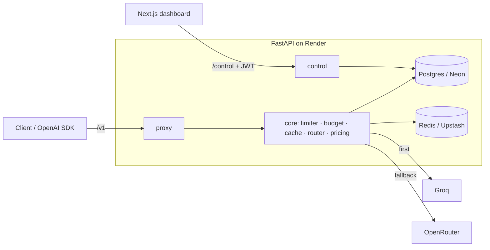

# LLM Gateway

An OpenAI-compatible LLM gateway: issued API keys, per-key rate limits, daily token budgets, a response cache and Groq → OpenRouter fallback, with usage and list-price cost tracked for every request.

**Live demo:** coming soon

## Use it

Point any OpenAI SDK at the gateway. Only `base_url` and `api_key` change:

```python
from openai import OpenAI

client = OpenAI(base_url="https://<api>/v1", api_key="lgw_...")
stream = client.chat.completions.create(
    model="gpt-oss-120b",
    messages=[{"role": "user", "content": "Hi"}],
    stream=True,
)
for chunk in stream:
    print(chunk.choices[0].delta.content or "", end="")
```

Every response carries `x-gateway-provider`, `x-gateway-cache` and `x-gateway-attempts` headers, plus an `x_gateway` object in the body with the list-price cost and time to first token.

## Architecture



`proxy/` (the hot path) and `control/` (the dashboard API) never import each other; both depend only on `core/` and `db/`.

## Engineering notes

**Race-safe budgets.** Each request reserves its worst-case token count (prompt estimate + `max_tokens`) before calling a provider, and settles to the real usage afterwards. One Lua script checks and increments the user's daily budget and the global cap together, so concurrent requests can't both slip under the limit. A test fires 50 parallel reservations at a budget that fits 30 and asserts exactly 30 get in. If the process dies between reserve and settle, the reservation stays held until midnight UTC: the failure mode is under-serving, never overspending.

**Fallback only before the first token.** If Groq times out, rate-limits or errors before sending anything, the request moves to OpenRouter and the client never notices. Once a token has reached the client the answer can't be stitched from two models, so a mid-stream failure ends the stream with an error event and is recorded as `partial`. A per-provider circuit breaker skips a provider after 5 consecutive failures for 30 seconds.

**SHA-256 for API keys, not bcrypt.** Keys are 256-bit random secrets, so a slow hash adds no security, and a fast deterministic one allows an indexed lookup on every request. Resolved keys are cached in Redis for 60 seconds, and revoking a key deletes that cache entry so it stops working immediately.

**Fail closed when Redis is down.** Without Redis the gateway can't enforce rate limits or budgets, so it answers `503` instead of serving unmetered traffic.

**Single-instance shortcut.** The circuit breaker lives in process memory. That's correct while the API runs as one instance (Render's free tier); moving it to Redis is the upgrade path if it scales out.

## Local setup

```bash
docker compose up -d --wait
cd api && cp .env.example .env && uv sync && uv run alembic upgrade head
uv run uvicorn --factory app.main:create_app --reload
```

## Tests

```bash
cd api && uv run pytest --cov
```

The suite runs against real Postgres and Redis from Docker Compose: the Lua rate-limit and budget scripts are exercised for real, including the concurrency tests. Providers are faked with `httpx.MockTransport`, and the proxy tests run a real uvicorn server, so streaming, client disconnects and the official `openai` SDK are tested end to end.

## Privacy

Prompts and answers are never stored in Postgres or logs. Only the response cache holds answer text, scoped per user, and it expires after 24 hours.
